# URUMAYA — Rooted in Heritage

**Full-Stack E-Commerce | Inventory Management | Customer Relationship Management**

URUMAYA is a full-stack e-commerce platform designed to celebrate Sri Lankan heritage and traditional craftsmanship. It combines a modern shopping experience with heritage storytelling, inventory management, order processing, and customer relationship management through a centralized, role-based management system.

## Live Website

- **Live Application:** [urumaya-store.vercel.app](https://urumaya-store.vercel.app/)
- **Live Demo:** [Explore URUMAYA](https://urumaya-store.vercel.app/demo)

Explore the platform using the available Customer, Staff, and Admin demo accounts without creating an account.

## Project Screenshots

### Homepage

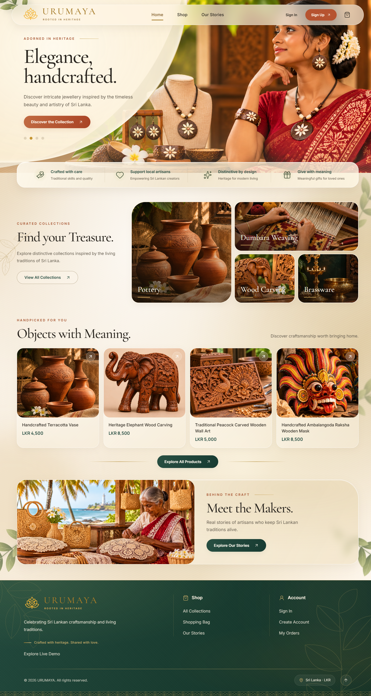

<details>
<summary><b>Customer Storefront</b></summary>

### Shop

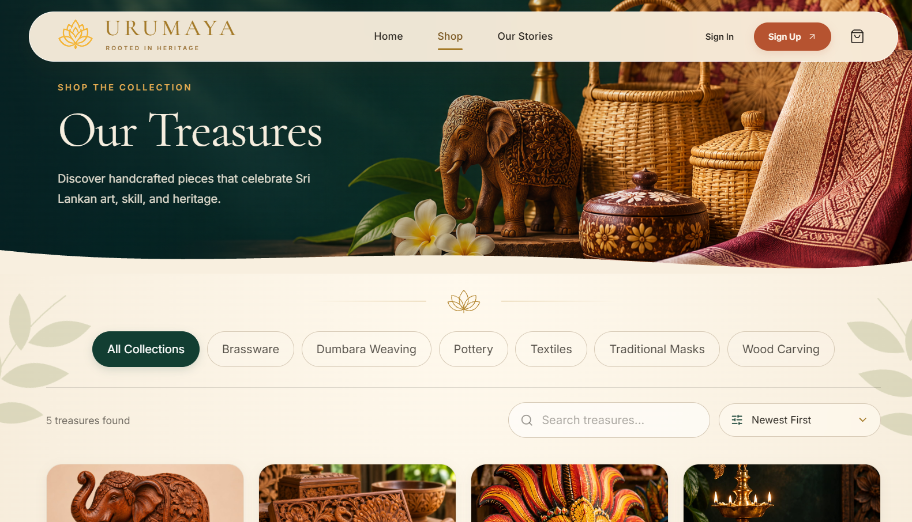

### Product Details

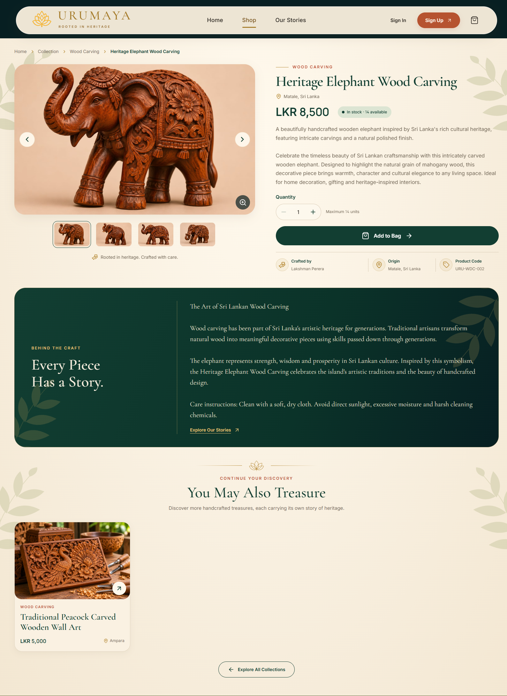

### Shopping Cart

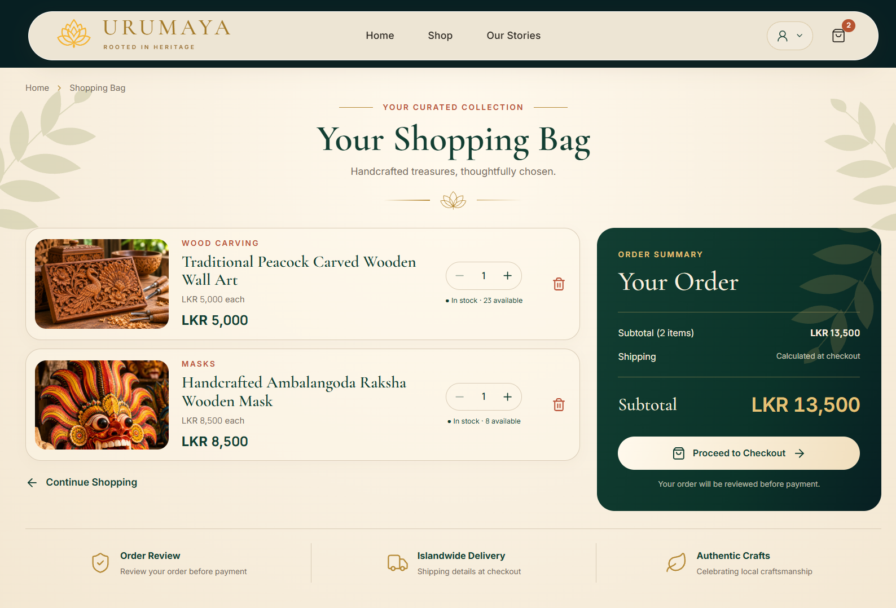

### Checkout

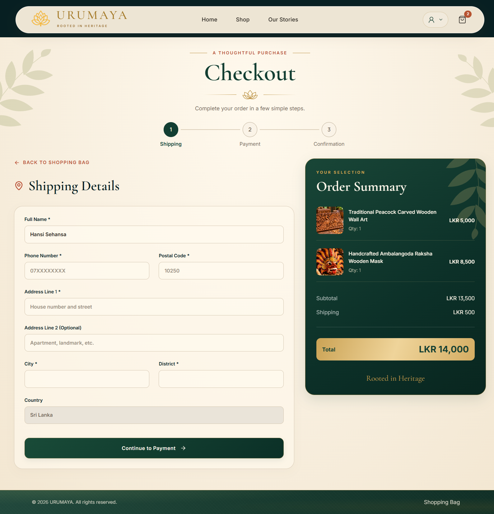

</details>

<details>
<summary><b>Heritage Storytelling</b></summary>

### Heritage Stories

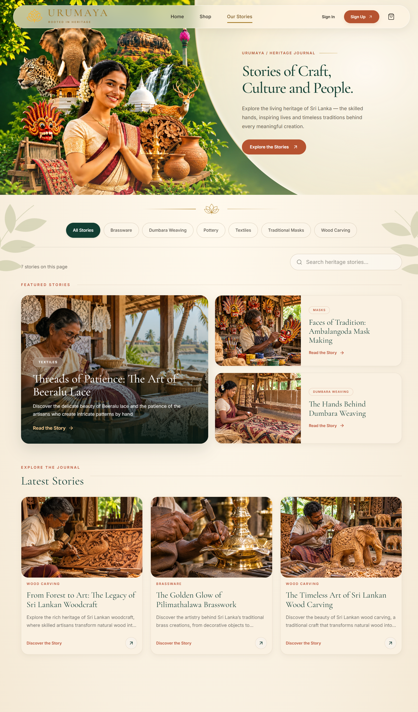

### Story Details

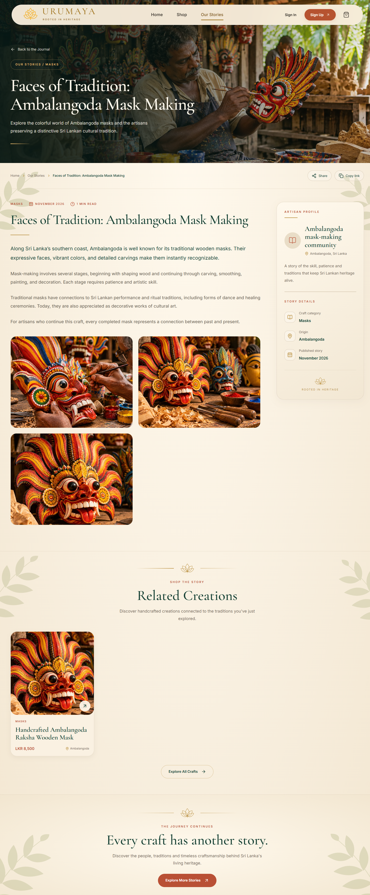

</details>

<details>
<summary><b>Management System</b></summary>

### Admin Dashboard

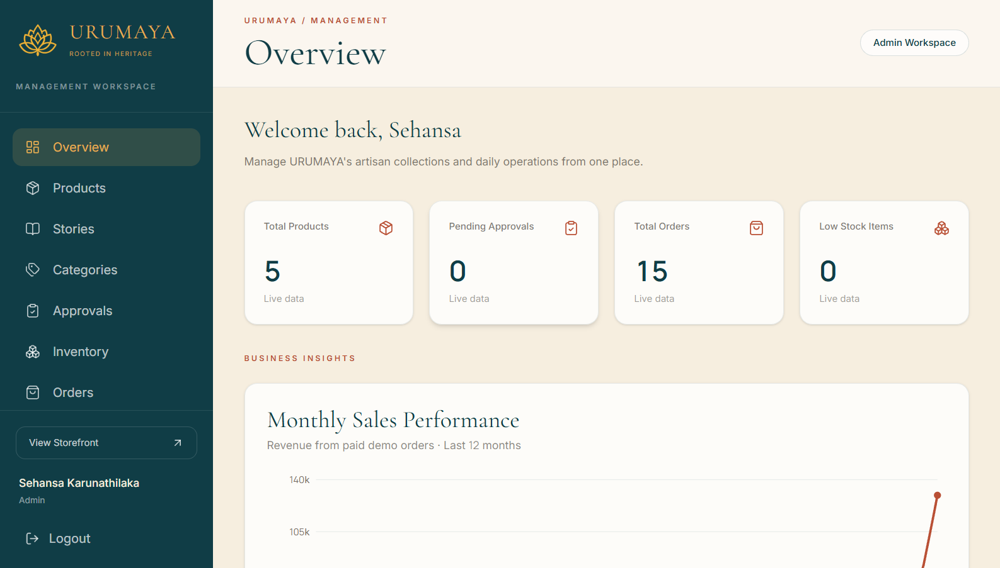

### Staff Dashboard

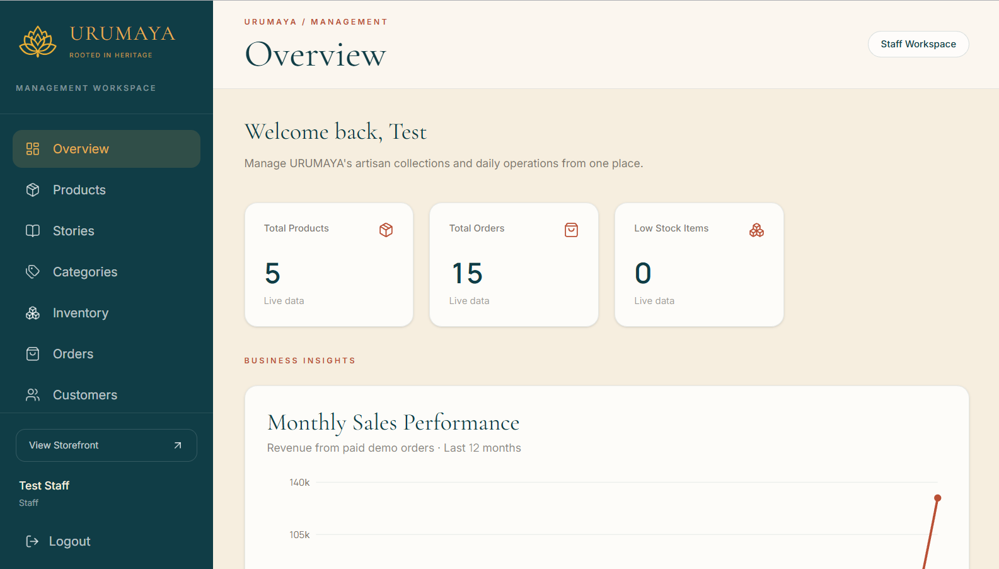

### Inventory Management

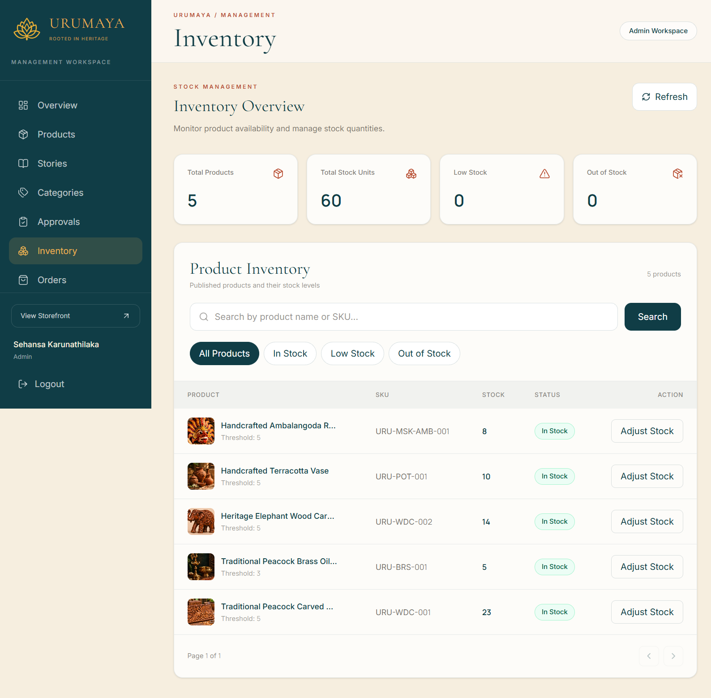

### Business Reports

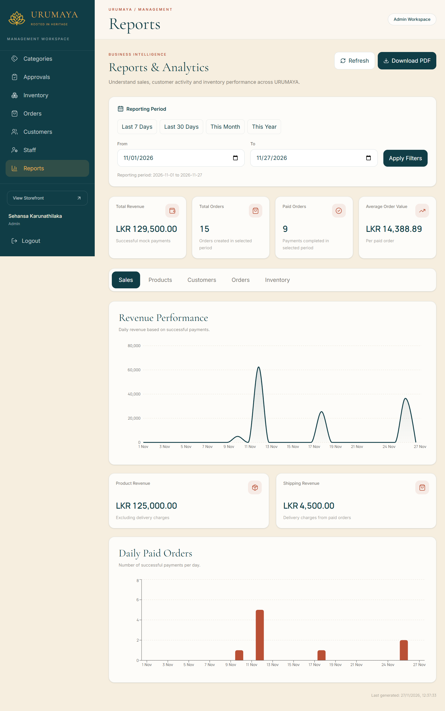

</details>


## Core Features

### Customer Storefront

- Responsive and interactive shopping experience
- Product browsing, searching, filtering, sorting, and pagination
- Detailed product pages
- Shopping cart management
- Checkout with mock payment processing
- Order confirmation and order history
- Customer account management
- Heritage storytelling and Shop the Story experience

### Staff Management

- Role-based management dashboard
- Product creation and management
- Product submission for administrative approval
- Inventory and stock management
- Low-stock monitoring
- Order processing and status management
- Customer information management
- Heritage story creation and submission

### Admin Management

- Administrative dashboard with business analytics
- Product approval and rejection
- Product category management
- Inventory oversight
- Order and customer management
- Staff account management
- Heritage story approval and publishing
- Business reporting

## Technology Stack

| Layer               | Technologies                               |
| ------------------- | ------------------------------------------ |
| Frontend            | React.js, Vite, Tailwind CSS, React Router |
| Backend             | Node.js, Express.js                        |
| Database            | MongoDB Atlas, Mongoose                    |
| Authentication      | JWT, bcryptjs, HTTP-only cookies           |
| API Communication   | REST APIs, Axios                           |
| Image Management    | Cloudinary                                 |
| Validation          | Zod                                        |
| Data Visualization  | Recharts                                   |
| Version Control     | Git, GitHub                                |
| Frontend Deployment | Vercel                                     |
| Backend Deployment  | Render                                     |

## System Architecture

```text
React Frontend
      |
      | REST API / HTTPS
      |
Vercel API Proxy
      |
Express.js Backend
      |
      +-- Authentication & Authorization
      +-- Product & Inventory Management
      +-- Cart & Order Management
      +-- Customer & Staff Management
      +-- Heritage Story Management
      +-- Analytics & Reporting
      |
      +-- MongoDB Atlas
      +-- Cloudinary
```

## Authentication and Security

- JWT-based authentication
- Access and refresh token management
- HTTP-only refresh cookies
- Secure password hashing using bcrypt
- Role-based access control
- Protected API endpoints
- Server-side input validation
- Authentication rate limiting
- Environment-based configuration
- Restricted demo account permissions

## Product Approval Workflow

1. Staff creates and submits a product for approval.
2. The product is marked as pending approval.
3. Admin reviews the product information.
4. Admin approves or rejects the submission.
5. Approved products become available in the customer storefront.

## Order and Inventory Management

URUMAYA implements an integrated order and inventory workflow that includes:

- Stock availability validation
- Stock reservation during checkout
- Transaction-based order processing
- Mock payment confirmation
- Automatic stock restoration for failed or expired payments
- Order status tracking
- Inventory adjustments and low-stock monitoring

## Heritage Storytelling

URUMAYA goes beyond traditional e-commerce by connecting products with Sri Lankan cultural heritage.

Customers can discover the stories behind handcrafted products, explore cultural traditions, and browse related products through the Shop the Story experience.

## Live Demo Access

| Role     | Available Experience                                                        |
| -------- | --------------------------------------------------------------------------- |
| Customer | Explore products, collections, and heritage stories                         |
| Staff    | Explore product, inventory, order, and customer management                  |
| Admin    | Explore administrative dashboards, analytics, reports, and staff management |

Demo accounts have restricted permissions to protect application data. Public registration is disabled in the hosted portfolio demonstration.

## Production Reliability

- Independent public and authenticated API clients
- Backend readiness checking
- Automatic retries for temporary public API failures
- Loading skeletons and extended loading notifications
- User-friendly error handling
- Persistent authentication sessions

## Project Structure

```text
URUMAYA/
├── frontend/
│   ├── public/
│   └── src/
│       ├── api/
│       ├── components/
│       ├── context/
│       ├── pages/
│       └── styles/
├── backend/
│   └── src/
│       ├── config/
│       ├── middleware/
│       ├── modules/
│       └── scripts/
├── .gitignore
└── README.md
```

## Local Development

### Prerequisites

- Node.js
- npm
- MongoDB Atlas account
- Cloudinary account

### Clone the Repository

```bash
git clone https://github.com/Sehansa03/URUMAYA.git
cd URUMAYA
```

### Backend Setup

```bash
cd backend
npm install
```

Create a `.env` file inside the backend directory with the required configuration:

```env
PORT=5000
NODE_ENV=development
CLIENT_URL=http://localhost:5173
MONGODB_URI=your_mongodb_connection_string
MONGODB_DB_NAME=your_database_name
JWT_ACCESS_SECRET=your_secure_secret
CLOUDINARY_CLOUD_NAME=your_cloud_name
CLOUDINARY_API_KEY=your_api_key
CLOUDINARY_API_SECRET=your_api_secret
ENABLE_DEMO_LOGIN=false
ENABLE_PUBLIC_REGISTRATION=true
```

Start the backend:

```bash
npm run dev
```

### Frontend Setup

Open a separate terminal:

```bash
cd frontend
npm install
```

Create a `.env` file inside the frontend directory:

```env
VITE_API_URL=http://localhost:5000/api/v1
```

Start the frontend:

```bash
npm run dev
```

## Project Status

Developed, deployed, and available as a full-stack software engineering project.

The application uses demonstration data and mock payment processing. No real financial transactions are performed.

The hosted backend may require additional startup time after periods of inactivity due to free-tier hosting limitations.

## Future Enhancements

- Real payment gateway integration
- Automated CI/CD testing
- Advanced audit logging
- Email notifications
- Performance optimization

## Author

**Sehansa Karunathilaka**

BICT (Hons) Undergraduate | Aspiring Software Engineer

---

**URUMAYA — Rooted in Heritage**

Celebrating Sri Lankan craftsmanship through technology.

